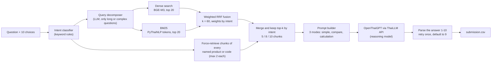

# FahMai RAG: Intent-Aware Hybrid Retrieval for Thai Product Q&A


-7A5AF8)


Entry for the **FahMai RAG Challenge** (Super AI Engineer Season 6, Level 1): answer 100 Thai multiple-choice questions about an online electronics shop, using only the shop's Markdown knowledge base and a Thai LLM API.

**Result:** the on-time submission (`submission_v4`) scored 0.80 private and 0.78 public. The final pipeline in this repository (`submission_v5`) scored 0.85 private and 0.75 public, but it was submitted after the deadline, so it did not count for the ranking.


The screenshot has no column headers. I read the first number as the private score and the second as the public score, following Kaggle's submissions table. The organizers' slides say the public leaderboard uses 60% of the questions and the private one 40%, which decides the final rank.

## The problem

- 100 questions, 10 choices each. Choices 1 to 8 are content answers, **choice 9 means "not in the knowledge base"** and **choice 10 means "unrelated to the shop"**.
- Knowledge base: 118 Markdown documents (110 products, 5 policies, 3 store-info pages), cut into 857 chunks.
- The answer must come from a ThaiLLM API model; the metric is accuracy.

A single retriever fails because the questions are of very different kinds: one spec lookup, a comparison of several products, a price or points or shipping calculation that needs a policy file, or a long paragraph with the real question buried at the end.

## Approach (V5)



| Intent | Questions | Chunks sent to the LLM |
|---|---|---|
| `SIMPLE_FACT` (one product, one spec) | 50 | 5 |
| `MULTI_PRODUCT` (three or more products) | 24 | 10 |
| `POLICY_CALC` (policy plus a calculation) | 16 | 8 to 10 |
| `COMPARE` (two products) | 9 | 8 |
| `LONG_CONTEXT` (question buried in a story) | 1 | 8, after query decomposition |

Design choices:

- **Rule-based intent routing** is free and instant, and sets how much context each question gets and how the prompt is written.
- **Hybrid retrieval**: BGE-M3 embeddings catch paraphrases, BM25 over PyThaiNLP-tokenized text catches product codes and Thai brand names; they are fused with reciprocal rank fusion, weighted by intent.
- **Forced retrieval**: every product named in the question is guaranteed a place in the context through a reverse index (product name to chunks), which is what makes comparison questions answerable.
- **Prompt modes** tell the model how to handle choices 9 and 10 and how to do the arithmetic for policy questions.
- **Robust parsing**: the reasoning model returns a long `<think>` block, so `max_tokens` is large; if no answer is found the call is retried once, then defaults to 9.
- A debug helper (`debug_v5`) and a single-question re-run helper are included.

## Results

| Submission | Private score (40% of the questions) | Public score (60%) | Note |
|---|---|---|---|
| `submission_v4` | 0.80 | 0.78 | on time |
| `submission_v5` (this notebook) | **0.85** | 0.75 | after the deadline |

The answers are spread over all ten choices (choices 1 to 8 between 6 and 13 times each, choice 9 eleven times, choice 10 four times), so the pipeline does not collapse to a single option. The data has no answer key, so there is no per-question error analysis here. With 40 private and 60 public questions, one question moves a score by 0.025 or 0.017, so the v4 to v5 differences should not be over-read.

## Repository layout

```
notebooks/fahmai_rag_v5.ipynb          final pipeline (the API key is replaced by a placeholder)
notebooks/archive/                     the previous save of the same notebook
results/submission_v5.csv              the submitted answers (question id and option only)
data/README.md                         the data the notebook expects (the competition data is not included)
docs/leaderboard_submissions.png       score screenshot
```

## Run

[](https://colab.research.google.com/github/Taiga0727/fahmai-rag-intent-aware/blob/main/notebooks/fahmai_rag_v5.ipynb)

1. Get the competition data (see [`data/README.md`](data/README.md)) and put it in `MyDrive/RAG/data/`. Open `notebooks/fahmai_rag_v5.ipynb` in Google Colab and mount Drive. The first run builds the BGE-M3 index (a few minutes on a GPU) and caches it in `MyDrive/RAG/cache_v3/`.
2. Put your own ThaiLLM API key in the config cell (`THAILLM_API_KEY`); use a Colab secret rather than typing it into the notebook.
3. Run the cells in order. Paths are Colab paths (`/content/drive/MyDrive/RAG/...`).

`pip install -r requirements.txt` covers the libraries the notebook installs.

## Notes

- The competition data and the organizers' documents (brief, slides, starter kit) are not included. The notebook outputs were trimmed so that the per-question run log no longer quotes the questions; a few example queries used to test the intent classifier remain.
- The helper functions `ask_llm`, `bm25_retrieve`, `dense_retrieve` and `parse_answer` started from the organizers' starter kit and were changed to different degrees; the other 15 functions (intent classifier, query decomposition, forced retrieval, prompts, run loop, debug helpers) have no counterpart among the starter kit's function definitions. The MIT licence below covers my changes; the starter kit's own terms apply to what it contributed.
- Research and competition code, not a packaged library. License: [MIT](LICENSE) for the code and write-up; the competition data and the organizers' documents are not part of it.
