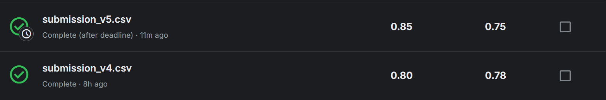
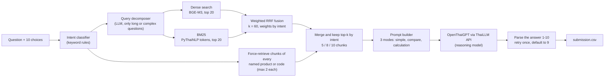

# FahMai RAG: Intent-Aware Hybrid Retrieval for Thai Product Q&A

Answers 100 Thai multiple-choice questions about an online electronics shop from the shop's Markdown knowledge base, with rule-based intent routing, hybrid BGE-M3 + BM25 retrieval and a Thai LLM. My entry to the **FahMai RAG Challenge** (Super AI Engineer Season 6, Level 1).

| Submission | Private score (40% of the questions) | Public score (60%) | Note |
|---|---|---|---|
| `submission_v4` | 0.80 | 0.78 | submitted on time |
| `submission_v5` (this repository) | **0.85** | 0.75 | submitted after the deadline, not ranked |

The screenshot has no column headers. I read the first number as the private score and the second as the public score, following Kaggle's submissions table. The organizers' slides say the private leaderboard (40% of the questions) decides the final rank.

[Problem](#problem) · [Approach](#approach) · [Limitations](#limitations) · [Run](#run) · [Credits](#credits-and-licence)

## Problem

- 100 questions with 10 choices each. Choices 1 to 8 are content answers, **choice 9 means "not in the knowledge base"** and **choice 10 means "unrelated to the shop"**.
- Knowledge base: 118 Markdown documents (110 products, 5 policies, 3 store-info pages), cut into 857 chunks.
- The answer must come from a ThaiLLM API model; the metric is accuracy.

One retriever is not enough because the questions differ in kind: a single spec lookup, a comparison of several products, a price, points or shipping calculation that needs a policy file, or a long story with the real question buried at the end.

## Approach

| Intent | Questions | Chunks sent to the LLM |
|---|---|---|
| `SIMPLE_FACT` (one product, one spec) | 50 | 5 |
| `MULTI_PRODUCT` (three or more products) | 24 | 10 |
| `POLICY_CALC` (policy plus a calculation) | 16 | 8 to 10 |
| `COMPARE` (two products) | 9 | 8 |
| `LONG_CONTEXT` (question buried in a story) | 1 | 8, after query decomposition |

- **Rule-based intent routing** is free and instant; it sets how much context a question gets and how the prompt is written.
- **Hybrid retrieval:** BGE-M3 embeddings catch paraphrases, BM25 over PyThaiNLP tokens catches product codes and Thai brand names, and reciprocal rank fusion weighted by intent merges them.
- **Forced retrieval:** every product named in the question is guaranteed a place in the context through a reverse index (product name to chunks), which makes comparison questions answerable.
- **Prompt modes** tell the model how to treat choices 9 and 10 and how to do the arithmetic for policy questions.
- **Robust parsing:** the reasoning model returns a long `<think>` block, so `max_tokens` is large; if no answer is found the call is retried once, then defaults to 9.
- A debug helper (`debug_v5`) and a single-question re-run helper are included.

## Limitations

- **Scores are coarse.** With 40 private and 60 public questions, one question moves a score by 0.025 or 0.017, so the v4 to v5 differences should not be over-read.
- **No error analysis.** The data has no answer key. As a sanity check, the answers spread over all ten choices (choices 1 to 8 between 6 and 13 times each, choice 9 eleven times, choice 10 four times), so the pipeline does not collapse to one option.
- **Data and organizer material are not included** (competition data, brief, slides, starter kit). The notebook outputs were trimmed so the run log no longer quotes the questions; a few example queries used to test the intent classifier remain.
- Research and competition code, not a packaged library.

## Run

1. Get the competition data ([`data/README.md`](data/README.md)) and put it in `MyDrive/RAG/data/`. Open `notebooks/fahmai_rag_v5.ipynb` in Google Colab (badge above) and mount Drive. The first run builds the BGE-M3 index (a few minutes on a GPU) and caches it in `MyDrive/RAG/cache_v3/`.
2. Put your own ThaiLLM API key in the config cell (`THAILLM_API_KEY`); the notebook ships a placeholder, and a Colab secret is safer than typing the key into the notebook.
3. Run the cells in order. Paths are Colab paths (`/content/drive/MyDrive/RAG/...`). Libraries: `requirements.txt`.

`results/submission_v5.csv` holds the submitted answers (question id and option only) and `notebooks/archive/` the previous save of the notebook.

## Credits and licence

The helpers `ask_llm`, `bm25_retrieve`, `dense_retrieve` and `parse_answer` started from the organizers' starter kit and were changed to different degrees; the other 15 functions (intent classifier, query decomposition, forced retrieval, prompts, run loop, debug helpers) have no counterpart among the starter kit's function definitions. [MIT](LICENSE) covers my changes for the code and write-up; the starter kit's own terms apply to what it contributed, and the competition data and organizer documents are not part of this repository.
